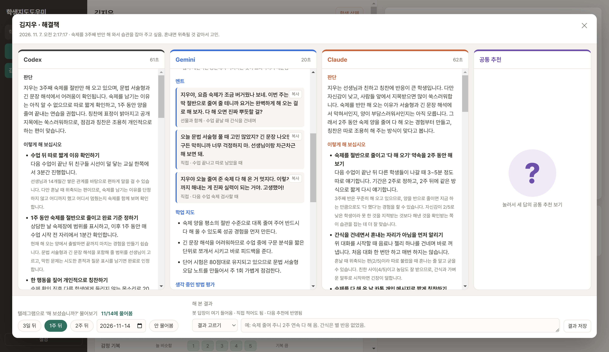
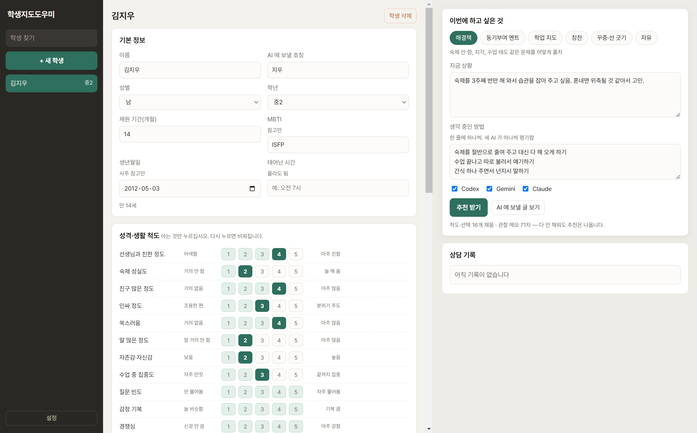
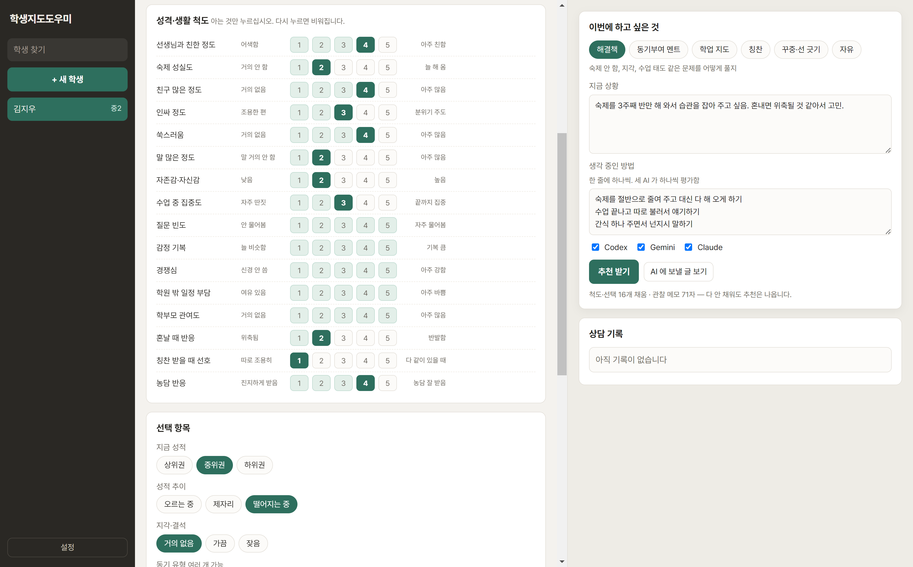
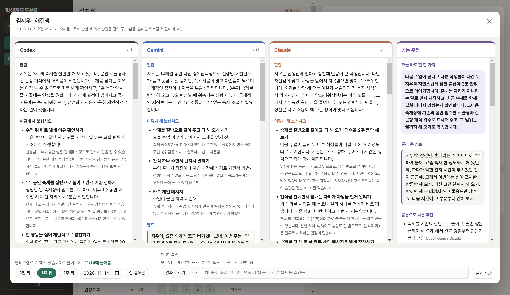

# 학생지도도우미

학생 정보와 선생님의 관찰을 넣으면 **Codex · Gemini · Claude 세 AI가 각자** 이 학생에게 어떤 방식으로, 어떤 말로 다가가면 좋을지 추천해 주는 Windows 데스크톱 앱입니다. 세 답에서 겹치는 추천은 네 번째 칸(물음표)에 따로 모아 줍니다.

API 키를 쓰지 않고, 선생님이 이미 구독 중인 계정(ChatGPT/Codex, Google Gemini, Claude)을 그대로 씁니다.



## 할 수 있는 것

- **학생 정보 입력**: 성별·학년·재원 기간, 성격·생활 척도 16개(친한 정도, 숙제 성실도, 쑥스러움, 혼날 때 반응, 칭찬 선호 등), 성적 추이, 동기 유형, 가정 상황, 학업 상태, 관찰 메모
  - 척도는 아는 것만 누르면 됩니다. 다 안 채워도 추천은 나옵니다.
  - MBTI와 생년월일(사주)은 참고로만 씁니다. 관찰과 안 맞으면 AI가 '참고 메모'로 한번 확인해 보라고 알려 주고, 추천은 선생님 관찰을 기준으로 합니다.
- **요청 종류**: 해결책 · 동기부여 멘트 · 학업 지도 · 칭찬 · 꾸중·선 긋기 · 자유
- **생각 중인 방법 평가**: '숙제를 절반으로 줄여 줄까?', '간식 주면서 넌지시 말할까?'처럼 한 줄씩 적으면 AI마다 추천 / 조건부 / 비추천으로 평가합니다.
- **결과 모달**: 판단, 방법(언제·어디서·얼마나), 바로 쓸 멘트(복사 단추), 학업 지도, 피할 것, 지켜볼 점, 참고 메모
- **공통 추천(물음표 칸)**: 세 답에서 겹치는 추천, 다른 의견, 오늘 바로 할 한 가지, 골라 둔 멘트
- **기록 저장**: 학생 정보와 상담 기록이 계속 쌓이고, 지난 상담과 해 본 결과가 다음 추천에 같이 넘어갑니다.
- **텔레그램 후속 확인(선택)**: 정해 둔 날(3일·1주·2주 뒤 등) 밤 10시에 봇이 '해 보셨습니까?'를 묻고, 답이 없으면 다음 날 오후 2시에 한 번 더 묻습니다. 단추와 한 줄 답장이 그대로 기록됩니다.

| 학생 정보 | 척도 | 공통 추천 |
|---|---|---|
|  |  |  |

## 준비물

- Windows 10/11, [Node.js](https://nodejs.org) 20 이상
- 세 AI 중 쓰고 싶은 것 (하나만 있어도 됩니다. 앱에서 체크로 고름)
  - **Codex**: Codex 앱(또는 `npm i -g @openai/codex`)에 로그인
  - **Claude**: [Claude Code](https://claude.com/claude-code) 설치 후 로그인 (`claude` 명령이 되어야 함)
  - **Gemini**: 따로 설치할 것 없음. 앱 안의 브라우저로 gemini.google.com 을 씁니다. 처음 한 번 앱의 **설정 → 제미나이 로그인 창 열기**에서 Google 계정으로 로그인하면 됩니다.
- 텔레그램 후속 확인을 쓰려면 Python 3.10 이상 + `pip install requests`

## 설치와 실행

```bat
git clone https://github.com/bycheul1-tech/student-guidance-helper.git
cd student-guidance-helper
설치.bat
```

그 뒤로는 `시작.bat` 을 두 번 누르면 켜집니다.

기록은 앱 폴더 `data\db.json` 에 저장되고(직전 판은 `db.bak.json`), 이 폴더는 GitHub에 올라가지 않습니다.

## 텔레그램 후속 확인 봇 (선택)

1. 텔레그램에서 [@BotFather](https://t.me/BotFather)에게 `/newbot` 을 보내 봇을 만들고 토큰을 받습니다.
2. [@userinfobot](https://t.me/userinfobot) 등으로 내 텔레그램 숫자 id 를 확인합니다.
3. `.env.example` 을 `.env` 로 복사해서 토큰과 id 를 넣습니다.
4. 만든 봇과 대화를 열고 **시작**을 누릅니다.
5. `봇시작.bat` 을 실행합니다. PC 를 켤 때마다 자동으로 켜지게 하려면 `봇시작.bat` 바로가기를 시작프로그램 폴더(`Win+R` → `shell:startup`)에 넣으십시오.

봇 명령: `/wait` 기다리는 목록 · `/now` 지금 물어볼 것 바로 묻기 · `/help` 안내

봇은 `data\db.json` 을 읽기만 하고, 받은 답은 `data\inbox.jsonl` 에 쌓습니다. 앱이 켜져 있으면 1분마다, 꺼져 있으면 다음에 켤 때 합칩니다.

## 알아 둘 점

- 학생 정보는 세 AI 회사로 보내집니다. 'AI 에 보낼 호칭' 칸을 쓰면 실명 대신 그 호칭이 갑니다. 'AI 에 보낼 글 보기' 단추로 실제로 보내는 글을 확인할 수 있습니다.
- 제미나이 웹 방식은 구글이 화면을 바꾸면 고쳐야 할 수 있습니다(`lib/gemini_web.js` 의 `SEL`). 질문할 때마다 제미나이 웹의 최근 대화 목록에 대화가 하나씩 남습니다.
- AI 추천은 참고용입니다. 학생을 가장 잘 아는 사람은 선생님입니다.

## 파일 구조

```
main.js            앱 본체(창, 저장, 세 AI 동시 호출, 공통 추천)
preload.js         화면과 본체 연결
lib/fields.js      입력 칸 정의(척도·선택 항목·요청 종류)
lib/prompt.js      AI 에 보내는 글과 판단 규칙
lib/ai.js          Codex·Claude CLI 호출, Gemini 연결
lib/gemini_web.js  제미나이 웹 자동 입력·답 읽기
lib/store.js       data\db.json 저장
renderer/          화면(HTML·CSS·JS)
followup_bot.py    텔레그램 후속 확인 봇
```
